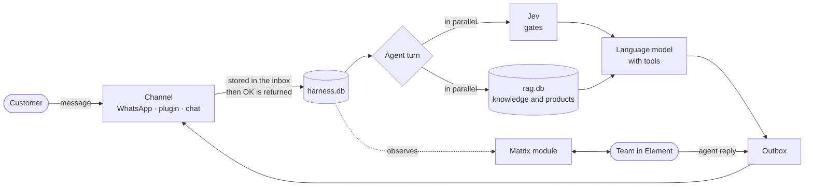
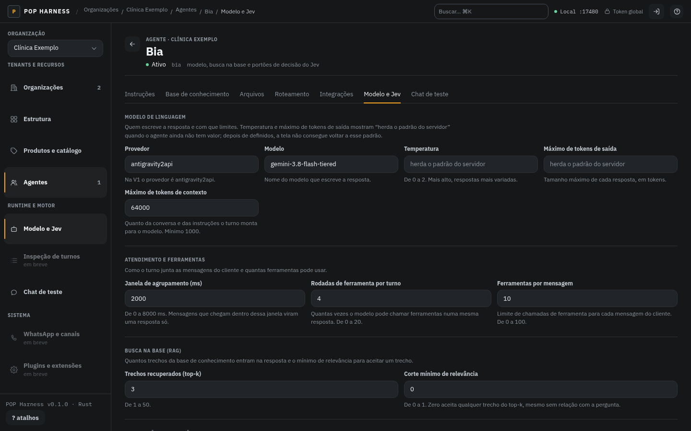
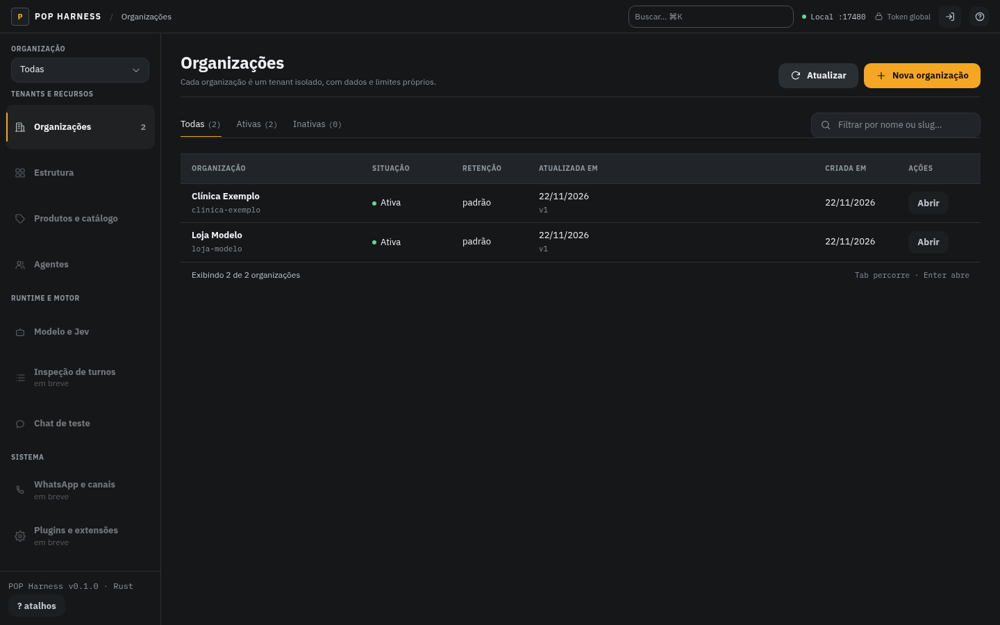
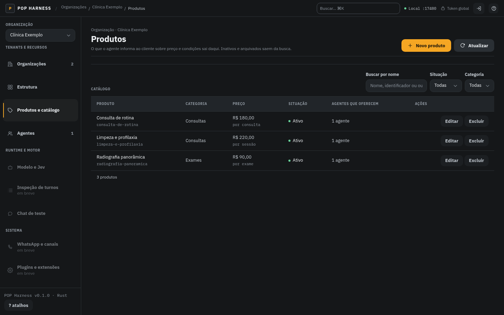

<div align="center">

# POP Harness

**An AI customer-service engine that runs many companies' agents on one instance.**
One Rust binary, backed by SQLite. No Redis, no Postgres, no agent framework.

[](https://github.com/vallewillian-source/pop-harness/actions/workflows/ci.yml)
[](LICENSE)
[](rust-toolchain.toml)
[](CONTRIBUTING.md)

[Quick start](#quick-start) ·
[What it does](#what-it-does) ·
[Flows and Cases](#flows-and-cases) ·
[Human handoff](#human-handoff-with-matrix-and-element) ·
[Documentation](#documentation) ·
[Contributing](#contributing)

English · [Português](README.pt-BR.md)

</div>

> **Language note.** Project files (README, contributing guide, security policy, templates, roadmap) are in
> English. The code, identifiers, comments and the technical documents under `docs/` are still in
> Brazilian Portuguese, as is the Console interface and the example agents' conversations. Issues and pull
> requests are welcome in English or Portuguese, and translations of `docs/` are welcome.

---

## What it is

POP Harness receives a customer's message, decides what to do, looks things up in the company's knowledge
base and catalog, writes the reply with a language model, delivers it through the channel the message came
from, and records every step so the answer can be explained later.

It is designed for people who need to **run many companies' support agents on the same server**, keeping each
company isolated from the others, and hand the conversation to a person when needed.

In practice you get:

- **One installation, many companies.** Each company (an *org*) has its own agents, knowledge base, products,
  files, integrations and tokens. Nothing is shared between orgs.
- **One process.** The `poph` binary contains the CLI, the admin API, the web Console (React, embedded) and
  the server. Data lives in two SQLite files and one folder of attachments.
- **Answers you can explain.** Every turn records what the agent looked up, which tools it called, what the
  Jev decided and how long each stage took. The Console shows it in a "why" panel.
- **Human handoff.** A transferred conversation stops being answered by the agent. Your team replies in
  Element (Matrix) and the reply reaches the customer on the original channel.
- **Step-by-step service.** Flows written as plain-text scripts that both an AI agent and a person can read,
  and one *Case* (record) per conversation with the history of what happened.

> The project is at `0.x`: the API, file formats and commands may change before `1.0`. Read
> [Known limitations](#known-limitations) before going to production.

> **Status as of 2026-11-22: parts of this page describe what is being built.** Already working in the code:
> multi-org, agents, knowledge base, WhatsApp, files, Jev, Matrix/Element (text) and the Case created for each
> conversation. **Still in development:** the `poph flow` and `poph ficha` commands, flow effects and
> revisions, Matrix media (images and files) and multiple Matrix instances. Status per item is in
> [ROADMAP.md](ROADMAP.md). Where this page disagrees with the binary, trust the binary and `ROADMAP.md`.

## Who it is for

**A good fit if you:**

- have an engineering team and want to host AI support with your own data and your own keys;
- serve several companies (agency, software house, SaaS) and need isolation between them;
- want control over what the agent can do: per-agent enabled tools, sending only files from the agent's
  library, configurable handoff to humans;
- care about memory use and about having few moving parts to operate.

**Probably not what you need if you:**

- want a finished product with sign-up and billing for a company without technical staff. Harness is the
  engine: the Console is administrative, not a customer-facing area;
- need audio, video, e-mail or a website widget. Today the native channel is WhatsApp (through EvolutionAPI)
  and there is a contract for writing other channels as plugins;
- need a ready-made catalog of LLM providers. Today the model client talks to an OpenAI-compatible endpoint
  (see [Known limitations](#known-limitations)).

## What it does

### Service

| Feature | How it works |
|---|---|
| **Orgs (tenants)** | Isolation by `org_id` in every table, in the search index and in the caches. An org token only sees its own org; a global token administers all of them. |
| **Agents and instructions** | Structured instructions (identity, rules, scope, steps, tone, tools) composed into a stable prompt, or a hand-written prompt. The per-agent tool list **really filters** what the agent may call. An inactive agent does not answer. |
| **Knowledge base** | Hybrid search (vector + text) over short chunks, with a per-agent relevance cutoff. Embeddings run **locally** (multilingual MiniLM, ONNX, int8): no knowledge-base text goes to an embedding service. |
| **Products and quotes** | Catalog by category, product lookup by name, alias or tag, and a quote cart per conversation. The agent looks prices up instead of making them up. |
| **Files** | Incoming images (seen by the model) and PDF/Office files (read as text, in an isolated process with memory and time limits). The agent only sends files from its own library, never an arbitrary path. |
| **Conversation memory** | Context window sized by token budget, with a rolling summary. Idle conversations leave memory and come back from the database. |
| **Grouping window** | A short wait (default 2 s, cap 8 s) to merge consecutive customer messages into a single reply. |
| **Model failure** | The message is retried later, with a retry limit. The customer gets no error notice and the message is never left unanswered. |

### Jev: optional fast decisions

The **Jev** is an external service that answers choose-among-known-options questions (transfer or continue,
wait or process now, which product). It avoids spending the text model on decisions a classification can
make. The principle is fixed: **the Jev chooses, the code validates and executes, and a Jev failure falls
back to the behavior without it.**

| Gate | Decides | Default |
|---|---|---|
| G1 | transfer to a person now | off |
| G2 | wait for more messages or process now | off |
| G3 | the message needs knowledge base, product lookup or nothing | on |
| G4 | which department receives the transfer | off |
| G5 | which product the customer wants | on |
| G6 | the reply may be sent or must be rewritten | off |
| G7 | prompt injection or abuse | off |
| G8 | the customer ended the conversation | on |
| G9 | start a flow (see [Flows and Cases](#flows-and-cases)) | on when the agent has a flow granted |

The Jev itself is off by default (`jev.ativo = false`) and each gate can be switched globally or per agent.
Details, measurements and calibration: [`docs/JEV.md`](docs/JEV.md).

### Channels

| Channel | Status |
|---|---|
| **WhatsApp** through [EvolutionAPI](https://github.com/EvolutionAPI/evolution-api) | Native: deduplicated webhook, QR-code pairing in the Console, text and file sending, incoming images and documents. |
| **External-process plugin** | Any program that speaks JSON-lines over stdio, with manifest, secrets and configuration described by JSON Schema. The server supervises the process with timeouts and restarts. Template: [`crates/poph-plugin-eco`](crates/poph-plugin-eco). |
| **Console test chat and `poph chat`** | Talk to the agent without a real channel, with streaming. |

Every message is delivered **at least once**: it is stored before the channel gets its OK, and output goes
through a durable queue. If the process dies mid-send the message is resent, so a duplicate is the only
possible failure. Full contract: [`docs/CONTRATO_CANAL.md`](docs/CONTRATO_CANAL.md).

### Operations

| Feature | How it works |
|---|---|
| **Web Console** | Organizations, structure (categories and departments), products, agents, knowledge base, files, routing, integrations, model and Jev, test chat with a "why" panel, instance health, org export/import, Matrix. |
| **Admin API** | `/admin/v1`, documented as OpenAPI 3.1 (`/admin/v1/openapi.json`). Edits use `If-Match` (optimistic concurrency), cursor pagination and a single error format. |
| **`poph` CLI** | Everything the Console does is also available from the terminal, with a stable `--json` format. |
| **Cluster** | Several instances with static per-org routing, in a `cluster.toml` identical on all of them. A webhook, admin call or live chat that lands on the wrong instance is forwarded, signed, to the owning one. |
| **Backup** | A whole org in a single file, with restore. Importing over existing data is refused by default. Secrets are never stored in clear text in the file. |
| **Retention** | History expires per org (default 30 days; `0` keeps everything). The sweep has `--dry-run`. |
| **Observability** | `/healthz`, Prometheus metrics at `/metrics`, human-readable or JSON logs, `poph doctor`. Secrets never reach the logs; the Matrix and Flows modules also keep customer text and phone numbers out of them. |
| **Secrets** | Environment only. Integration secrets are encrypted at rest. The `Sensivel` type prints `[oculto]` in logs and errors. Admin tokens are stored as Argon2id hashes. |

## How it works



1. **Input.** The channel delivers the message. It is stored in the `inbox` under a unique channel + external
   id key, so duplicates are dropped. If the org lives on another instance, the request is forwarded.
2. **Per-conversation queue.** One actor per conversation, one turn at a time.
3. **Grouping.** A short wait to merge messages sent in sequence.
4. **In parallel:** one Jev call with the questions of every enabled gate, and the knowledge-base and product
   search. If G1 says transfer, the turn ends without calling the model.
5. **Agent loop.** A prompt with a stable prefix (to benefit from provider-side caching) and a volatile block
   after it. Streaming model with the enabled tools: `consultar_base`, `buscar_produto`, `enviar_arquivo`,
   quote cart and the flow tools. File text and retrieved passages enter marked as **data**, never as
   instructions.
6. **Output.** The reply goes to the `outbox`, idempotent per turn and sequence, and the channel sends it.
7. **Record.** The turn stores Jev decisions, retrieved passages, tools, timings and tokens.

Design priorities, in order: deliver the message as fast as possible; use little memory; scale vertically
(thousands of agents) and horizontally (several instances); keep dependencies and processes few. Details:
[`docs/VISAO_GERAL.md`](docs/VISAO_GERAL.md) and [`docs/TURNO.md`](docs/TURNO.md).

## Quick start

You will build the project, create an org with an agent, and chat with it from the terminal and the Console.

### Requirements

- Linux (x86_64 or ARM64) with a C compiler (`gcc` or `clang`): SQLite and TLS compile C code.
- [Rust](https://rustup.rs). The version (`1.100.0`) is pinned in [`rust-toolchain.toml`](rust-toolchain.toml)
  and `rustup` installs it for you.
- For the Console: Node 22.18 or newer and [pnpm](https://pnpm.io). Without them the server starts with a
  minimal placeholder page instead of the Console.
- A language-model endpoint compatible with the OpenAI chat API, with streaming and tool calls. Without it
  everything starts and the Console works, but the agent cannot answer.

### 1. Build

```bash
git clone https://github.com/vallewillian-source/pop-harness.git
cd pop-harness
cargo build --release --workspace
```

This produces `target/release/poph` and `target/release/poph-extrator`. Keep both in the same folder: the
second one reads PDF and Office files in an isolated process. In the commands below `poph` means
`target/release/poph`: copy both into a folder on your `PATH` or use the full path.

To embed the Console in the binary, build the bundle first:

```bash
(cd console && pnpm install && pnpm build)
cargo build --release --workspace
```

### 2. Configure

Create a minimal `poph.toml`:

```toml
[servidor]
porta = 7480

[dados]
diretorio = "data"

[llm]
url_base = "http://127.0.0.1:8045/v1"   # your OpenAI-compatible endpoint
modelo   = "gemini-3.8-flash-tiered"    # the model it serves
```

Secrets live only in the environment:

```bash
export POPH_CHAVE_CIFRA="$(head -c 32 /dev/urandom | base64)"   # keep it: it encrypts stored secrets
export ANTIGRAVITY_API_KEY='<the key for your model endpoint>'
```

| Variable | Purpose | Required |
|---|---|---|
| `POPH_CHAVE_CIFRA` | encryption key for stored secrets | always |
| `ANTIGRAVITY_API_KEY` | key for the model endpoint | always |
| `TYPESAFE_API_KEY` | Jev | only with the Jev on |
| `EVOLUTION_API_KEY` | WhatsApp through EvolutionAPI | only with an `[evolution]` section |
| `POPH_CLUSTER_SECRET` | signing between instances | only with instances declared in `cluster.toml` |
| `POPH_MATRIX_AS_TOKEN`, `POPH_MATRIX_HS_TOKEN` | Matrix Application Service | only with `[matrix]` enabled |

All fields and variables: [`docs/CONFIGURACAO.md`](docs/CONFIGURACAO.md).

### 3. Check the environment and prepare the databases

```bash
poph --config poph.toml doctor          # checks config, data folder, databases and variables
poph --config poph.toml migrate         # creates harness.db and rag.db; safe to repeat
poph --config poph.toml model install   # downloads the embedding model (needs internet)
```

Without the embedding model the server starts and warns you, but `consultar_base` and `buscar_produto` stay
off. The model is about 118 MB and its checksum is verified on download.

### 4. Create the first org, agent and token

```bash
cat > prompt.md <<'EOF'
# Bia, assistant at Clínica Exemplo

Answer questions about appointments, exams and prices, in Portuguese, briefly and politely.
Use the knowledge base and the catalog before answering. If you do not know, say you will
ask the team to confirm.
EOF

poph --config poph.toml org create --name "Clínica Exemplo" --slug clinica-exemplo --offline
poph --config poph.toml --org clinica-exemplo department create --name "Atendimento" --offline
poph --config poph.toml --org clinica-exemplo agent create --name "Bia" --offline
poph --config poph.toml --org clinica-exemplo instructions create bia --markdown-file prompt.md --offline
poph --config poph.toml token global --label console
```

The token value is shown **once**. `token global` also prints an `[admin]` block with its hash: paste it into
`poph.toml`, because the configuration only stores the hash.

### 5. Chat

```bash
poph --config poph.toml --org clinica-exemplo chat bia      # from the terminal, with streaming
poph --config poph.toml serve                                # API + Console at http://127.0.0.1:7480
```

Open `http://127.0.0.1:7480/`, sign in with the token and use the agent's **Chat de teste** tab. From the
terminal or the Console, the conversation works without WhatsApp.

<p align="center">
  
</p>

To connect a WhatsApp number, add an `[evolution]` section (and `EVOLUTION_API_KEY`) and pair by QR code in
the agent's **Integrações** tab: [`docs/EVOLUTION.md`](docs/EVOLUTION.md).

## The Console

The Console is embedded in the binary and is for administering and testing. You sign in with a global or
org admin token.

<table>
  <tr>
    <td width="50%"></td>
    <td width="50%"></td>
  </tr>
  <tr>
    <td align="center"><sub>Organizations: each one is an isolated tenant.</sub></td>
    <td align="center"><sub>The catalog the agent looks up to quote prices.</sub></td>
  </tr>
</table>

The screenshots use demo data. To develop the Console with hot reload: `cd console && pnpm dev` (opens at
`http://localhost:5199` and proxies the API to port 7480). Screens and behavior: [`docs/CONSOLE.md`](docs/CONSOLE.md).

## CLI commands

All commands accept `--config <file>`. Those that touch an org's data require `--org <slug>` and, in several
cases, `--offline` (they operate directly on the database). `poph <command> --help` lists the options.

| Command | Purpose |
|---|---|
| `doctor`, `migrate`, `model install` | environment, databases and embedding model |
| `org`, `token` | orgs and admin tokens (`token global` creates the global one) |
| `agent`, `instructions` | agents and instructions |
| `department`, `category`, `product` | departments, categories and catalog |
| `kb`, `rag`, `file` | knowledge base, search index and the agent's file library |
| `flow`, `ficha` | flows (validate, publish, diff, format) and Cases |
| `chat <agent>` | chat from the terminal |
| `matrix` | Application Service registration and, per org, enable, disable and spaces |
| `cluster show`, `cluster check` | show and check the map between instances |
| `retention show`, `retention run --dry-run` | history retention |
| `backup export`, `backup import` | export and restore an org |
| `jev eval` | measure a Jev gate against a labeled set |
| `openapi` | print the OpenAPI document |
| `serve` | start the server, the API and the Console |

## Flows and Cases

### Case: the record of each conversation

Every conversation is born with a **Case**. It accumulates the messages, turns and flow executions of that
conversation, and it closes only when the conversation closes: by whoever is serving it, by an agent
(`atendimento_encerrar`), through the API, or by a flow that ends the conversation. After that, a new
customer message opens **another conversation and another Case**. A closed Case never changes.

> **Naming:** *Case* is the English name for what the Portuguese documentation, the database tables
> (`fichas`, `ficha_eventos`) and the CLI (`poph ficha`) call a **Ficha**. Identifiers in code are not renamed.
> See the [glossary](docs/GLOSSARY.md).

### Flow: a plain-text script

A flow describes steps, fields, actions and decisions. It is a text file in Starlark (a subset of Python)
with top-level declarations. The script **describes**; the state (current step, filled fields, history) lives
in the database. That is why a customer can disappear and come back days later, and why a server crash does
not lose the flow.

```python
fluxo(
    id = "triagem_suporte",
    nome = "Triagem de suporte",
    descricao = "Descobre o problema, classifica a urgência e encaminha o atendimento.",
    inicio = "relato",
    gatilho = gatilho(
        quando = "O cliente relata um problema técnico e precisa de ajuda para resolver.",
        nao_quando = "O cliente quer comprar, agendar visita ou falar de cobrança.",
        exemplos = ["meu sistema não abre", "deu erro ao emitir a nota"],
    ),
)

etapa(
    id = "relato",
    nome = "Ouvir o relato",
    instrucao = "Peça o que aconteceu e se o trabalho está parado agora. Uma pergunta por vez.",
    campos = [
        campo("resumo", "O que aconteceu", tipo = "texto", obrigatorio = True),
        campo("afeta_agora", "Está parado agora?", tipo = "opcao", opcoes = ["sim", "nao"], obrigatorio = True),
    ],
    acoes = [
        acao("registrado", "Relato registrado", exige = ["resumo", "afeta_agora"], vai_para = "classificar"),
        acao("nao_e_suporte", "Não é suporte", vai_para = fim("fora_de_escopo", resultado = "Fora do suporte")),
    ],
)

decisao(
    id = "classificar",
    se = igual("relato.afeta_agora", "sim"),
    entao = "urgente",
    senao = "normal",
)
```

The three complete examples, validated on every round, are in [`tests/fluxos/exemplos`](tests/fluxos/exemplos).

What this gives you in practice:

- **Flows belong to the org; agents only get permission.** A new flow is used by no agent until someone
  grants it. Switching agents does not lose the flow.
- **The Jev decides to start; the code starts.** The Jev picks a flow among those granted to the agent, the
  code checks it (active flow, granted, open Case, published revision) and only then starts it, before the
  model writes anything. If the Jev fails, the model gets the `fluxo_iniciar` tool as a fallback.
- **Immutable revisions.** Publishing creates revision `n+1`. Each execution stays pinned to the revision it
  started with. `flow diff` shows, in plain language, what changed and how many in-progress conversations
  remain on the old revision.
- **Errors that tell you what to do**, with line and column: "action `confirmar` requires field `cep`, which
  does not exist in step `coleta`". Warnings (a step with no exit, a field never required, an undefined
  variable in a message) do not block publishing.
- **The agent cannot advance on its own.** If the requested action does not exist in the current step, the
  answer is the error and the list of valid actions. There are no hidden transitions.
- **Explicit effects**: a fixed message to the customer, a WhatsApp notification to a team number, and a
  transfer to a department. They go out through a durable queue; a failed effect does not undo the
  transition and shows up as an event on the Case.
- **Scripts are untrusted input.** No clock, network, file or randomness, with limits on size, steps and
  memory per evaluation. `while`, recursion and `"x" * 1000000000` end in an error without hanging the
  server.

```bash
poph --org clinica-exemplo flow validar triagem_suporte.star      # errors and warnings, writes nothing
poph --org clinica-exemplo flow publicar triagem_suporte.star
poph --org clinica-exemplo flow diff triagem_suporte --de 1 --para 2
poph --org clinica-exemplo ficha listar --status open
```

Full language reference, the "configure → what happens" table and the list of diagnostics:
[`docs/FLUXOS_LINGUAGEM.md`](docs/FLUXOS_LINGUAGEM.md).

## Human handoff with Matrix and Element

The `poph-matrix` module mirrors each conversation into a Matrix room so your team can serve it in
[Element](https://element.io), and returns to the customer whatever the agent types. It can be **switched
off** (no `[matrix]` section, or `habilitado = false`, and none of it loads) and it is **not on the customer's
path**: it reads what the turn already stored and publishes to Synapse. With Synapse down, customer service
keeps working and the queue drains when it comes back.

- **One room per conversation**, named after the customer (the WhatsApp profile name; the phone number if
  there is none), with the customer's text and the agent's replies, in order and without duplicates.
- **Spaces per department.** The room goes to the space of the conversation's department and moves when the
  conversation is transferred. The space can be created by the module or linked to an existing one in Element.
- **Agent reply.** Whatever the person writes in Element reaches the customer on the same channel, prefixed
  with their name (`*[Name]*:`), and the conversation becomes `transferred`: the AI agent stops replying until
  it is reopened in the Console. A transaction repeated by Synapse does not cause a second send.
- **Room notices**: transfer, reopening, closing and definitive delivery failure to the customer.
- **Closing from Element.** The close button, conversation read and the customer's history in the room panel
  are served by the Harness API (conversation `GET`/`close`, per-customer listing).
- **Media and phone-typed messages.** Images and files both ways (up to 16 MB), a text notice for audio and
  video, and a message typed directly on the customer's phone appears as "Humano no Aparelho" and also
  pauses the agent.
- **Several instances on the same Synapse**, each owning the rooms it created.

```toml
[matrix]
habilitado     = true
homeserver_url = "https://synapse.example.com"
server_name    = "example.com"
prefixo        = "ph"        # prefix for virtual users and aliases (differs from other integrations on the Synapse)
```

```bash
export POPH_MATRIX_AS_TOKEN='<application service token>'
export POPH_MATRIX_HS_TOKEN='<homeserver token>'

poph matrix registro --saida registro.yaml --url https://harness.example.com   # writes the registration (mode 0600, never prints tokens)
# add registro.yaml to Synapse and restart Synapse: it only reads registrations at startup

poph --offline --org clinica-exemplo matrix ligar
poph --offline --org clinica-exemplo matrix espaco --departamento <id>
```

Synapse and Element are **yours**: Harness neither installs nor changes them. A development Synapse with two
registrations is described in [`docs/MATRIX_AMBIENTE_LOCAL.md`](docs/MATRIX_AMBIENTE_LOCAL.md). Memory,
throughput and resilience measurements: [`docs/MATRIZ_MEMORIA.md`](docs/MATRIZ_MEMORIA.md) and
[`docs/MATRIZ_RESILIENCIA.md`](docs/MATRIZ_RESILIENCIA.md).

## Measured numbers

These numbers come from development spikes and measurements (x86_64, one 12-core machine). **They are not a
full load test**: the test with 10,000 agents and 500 active conversations has not been run yet, so the
scale figures below are targets, not results.

| What | Measured |
|---|---|
| Memory per idle agent (full configuration) | 8.3 KB; 10,000 agents = 84 MB |
| Memory per agent with a vector index (200 chunks × 384 dimensions, int8) | 82.9 KB |
| Exact search for the top 3 chunks out of 200 | 13.5 µs (p50) |
| Internal turn path, from message to ready model request (no embedding, Jev or model) | 0.057 ms (p50) |
| SQLite with one batching writer | 118k messages/s saturated; 0.2 ms commit (p95) at 2,000 msg/s |
| `poph serve` with the Matrix module off (embedding model not loaded) | ~20 MB RSS |
| Matrix module on, 1,000 rooms | +6.5 MB over the server without the module |
| Embedding model loaded | ~458 MB RSS |

The latency a customer perceives is dominated by the language model (in the spike: first text at ~6.5 s and
complete reply at ~6.9 s), not by Harness. Method, caveats and how to repeat: [`docs/DECISOES.md`](docs/DECISOES.md)
(D-07), [`docs/MATRIZ_MEMORIA.md`](docs/MATRIZ_MEMORIA.md) and [`docs/MEMORIA_E_CONCORRENCIA.md`](docs/MEMORIA_E_CONCORRENCIA.md).

## Known limitations

Check this list before going to production. It is maintained together with the code.

- **Language model.** The model client sits behind an interface (`LlmProvider`), but the only bundled
  provider speaks the OpenAI chat dialect (`/chat/completions`, SSE, tools, images) and was exercised only
  against one specific gateway. The provider identifier in the configuration is still `antigravity2api`.
  Other compatible endpoints have **not been tested**.
- **Jev.** It is a third-party service. Without it Harness runs each gate's default behavior, just without
  the fast decisions. G1 (transfer) ships off until a new measurement round.
- **WhatsApp with a real number.** The channel was proven against a fake EvolutionAPI in an isolated
  environment. The test with a real number is still pending.
- **External plugin as a channel.** The contract, the supervisor and the sample plugin are ready and tested,
  but `poph serve` currently starts the plugin only to read its manifest. Receiving and sending customer
  messages through an external plugin inside the server is not wired yet.
- **Scale.** The memory and throughput targets for thousands of agents are set, but the full load test and
  search-parity measurement with a real agent have not been done.
- **ARM64.** The build is validated, but the ARM binary of the latest commit has not been rebuilt on ARM
  hardware.
- **No end-user login in the Console.** It signs in with the admin token; there is no per-person login, no
  roles and no per-token rate limit.
- **Linux only.** We have not tested macOS or Windows.
- **Console outside the POP Atende monorepo.** The Console depends on the `@sofacoding/sofa-ui` package, which
  has not been published yet. Without it, `cargo build` and `poph serve` work and show a minimal page, but the
  full Console bundle does not build from this repository.

## Code architecture

A Cargo workspace of small crates with one dependency rule: `poph-types` depends on no other crate, the
capability crates know nothing about the server or the CLI, and `poph-agent` (turn) and `poph-server` (HTTP)
glue the pieces together.

| Crate | What it does |
|---|---|
| `poph-types` | domain types, IDs, errors, contracts, configuration and `Sensivel` |
| `poph-core` | model-provider client (streaming, tools, images, per-org limit) |
| `poph-store` | SQLite (`harness.db`, `rag.db`): single writer, WAL readers, migrations, per-org repositories, backup |
| `poph-rag` | local embedding (ONNX Runtime, int8), batch queue and model install |
| `poph-files` | file intake, content-based type detection, isolated PDF/Office extraction |
| `poph-jev` | Jev client, gate framework and single question batch |
| `poph-fluxos` | flow compiler, validator, rules and engine; pure, no database or network |
| `poph-plugins`, `poph-plugin-eco` | stdio plugin supervision and a sample plugin |
| `poph-evolution` | EvolutionAPI (WhatsApp) client |
| `poph-matrix` | Matrix module: Application Service, rooms, spaces and virtual users |
| `poph-agent` | hot state, per-conversation actors, turn, context, knowledge base, products and cart |
| `poph-retention` | history retention |
| `poph-server` | admin API (axum), authentication, OpenAPI, embedded Console, cluster |
| `poph` | the binary: CLI and `serve` |

Full map, working rules and where each business rule lives: [`AGENTS.md`](AGENTS.md).

## Documentation

| To | Read |
|---|---|
| Understand the project | [`docs/VISAO_GERAL.md`](docs/VISAO_GERAL.md), [`docs/DECISOES.md`](docs/DECISOES.md) |
| Configure and operate | [`docs/CONFIGURACAO.md`](docs/CONFIGURACAO.md), [`docs/RUNBOOKS.md`](docs/RUNBOOKS.md), [`docs/CLUSTER.md`](docs/CLUSTER.md), [`docs/BACKUP.md`](docs/BACKUP.md), [`docs/RETENCAO.md`](docs/RETENCAO.md) |
| Use the API | [`docs/API.md`](docs/API.md) and `/admin/v1/openapi.json` |
| How a message becomes a reply | [`docs/TURNO.md`](docs/TURNO.md), [`docs/ENTRADA_E_SAIDA.md`](docs/ENTRADA_E_SAIDA.md), [`docs/MEMORIA_E_CONCORRENCIA.md`](docs/MEMORIA_E_CONCORRENCIA.md) |
| Agents, knowledge and products | [`docs/AGENTES.md`](docs/AGENTES.md), [`docs/BASE_DE_CONHECIMENTO.md`](docs/BASE_DE_CONHECIMENTO.md), [`docs/PRODUTOS.md`](docs/PRODUTOS.md), [`docs/ARQUIVOS.md`](docs/ARQUIVOS.md) |
| Jev | [`docs/JEV.md`](docs/JEV.md) |
| Channels and plugins | [`docs/CONTRATO_CANAL.md`](docs/CONTRATO_CANAL.md), [`docs/PLUGIN_PROTOCOLO.md`](docs/PLUGIN_PROTOCOLO.md), [`docs/PLUGIN_EXEMPLO.md`](docs/PLUGIN_EXEMPLO.md), [`docs/EVOLUTION.md`](docs/EVOLUTION.md) |
| Flows and Cases | [`docs/FLUXOS_LINGUAGEM.md`](docs/FLUXOS_LINGUAGEM.md) |
| Terms in English (Case = Ficha, Flow = Fluxo, ...) | [`docs/GLOSSARY.md`](docs/GLOSSARY.md) |
| Matrix and Element | [`docs/MATRIX_AMBIENTE_LOCAL.md`](docs/MATRIX_AMBIENTE_LOCAL.md), [`docs/DADOS.md`](docs/DADOS.md) §11 |
| Data and schema | [`docs/DADOS.md`](docs/DADOS.md) |
| Console | [`docs/CONSOLE.md`](docs/CONSOLE.md), [`console/UX_SPEC.md`](console/UX_SPEC.md) |
| Work on the code | [`CONTRIBUTING.md`](CONTRIBUTING.md), [`DEVELOPMENT.md`](DEVELOPMENT.md), [`AGENTS.md`](AGENTS.md) |
| What comes next | [`ROADMAP.md`](ROADMAP.md) |

## Contributing

Contributions are welcome: bug fixes, tests, documentation, channel plugins, new model providers. Before
opening a large pull request, open an issue so we can agree on the design.

- Read [`CONTRIBUTING.md`](CONTRIBUTING.md): how to set up, run the tests, the style and what we expect in a PR.
- The single verification command is `bash scripts/ci.sh` (formatting, clippy with `-D warnings`, tests, ARM
  check, licenses and dependency audit).
- Look for issues labeled `good first issue` and `help wanted`.
- Taking part means accepting the [Code of Conduct](CODE_OF_CONDUCT.md).
- Usage questions go to [Discussions](https://github.com/vallewillian-source/pop-harness/discussions). See
  [`SUPPORT.md`](SUPPORT.md).

## Security

Do not open a public issue for a security problem. Use GitHub's private report
(**Security → Report a vulnerability**). The process is in [`SECURITY.md`](SECURITY.md).

## License

POP Harness is distributed under the [GNU Affero General Public License v3.0 or later](LICENSE)
(`AGPL-3.0-or-later`). In short: you may use, study, modify and redistribute it, including commercially. If
you offer a modified version as a network service, you must make that version's source code available to the
service's users. Read the license text for the exact terms.

## Credits

Created and maintained by [SofaCoding](https://sofacoding.com.br). The project grew out of work on
[POP Atende](https://popatende.com.br) but is independent of it: it does not use its database or import its
code. "POP Harness" and "POP Atende" are SofaCoding product names.

Harness builds on, among others: [axum](https://github.com/tokio-rs/axum), [rusqlite](https://github.com/rusqlite/rusqlite),
[ONNX Runtime](https://onnxruntime.ai) through [`ort`](https://github.com/pykeio/ort), [Starlark](https://github.com/facebook/starlark-rust)
and the [paraphrase-multilingual-MiniLM-L12-v2](https://huggingface.co/sentence-transformers/paraphrase-multilingual-MiniLM-L12-v2) model.
The full list of dependencies and licenses is in `Cargo.lock` and is enforced by `cargo deny`.
