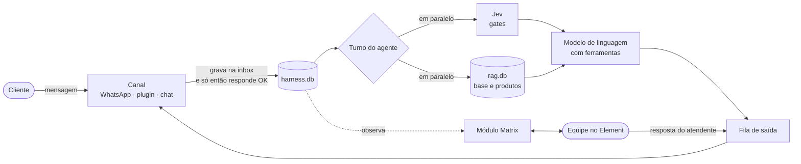
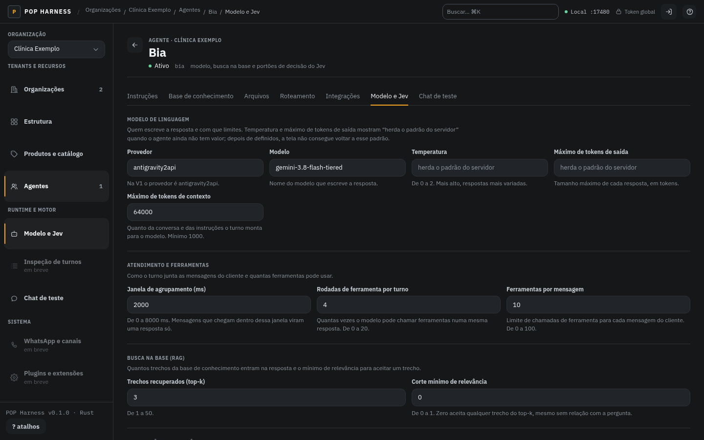
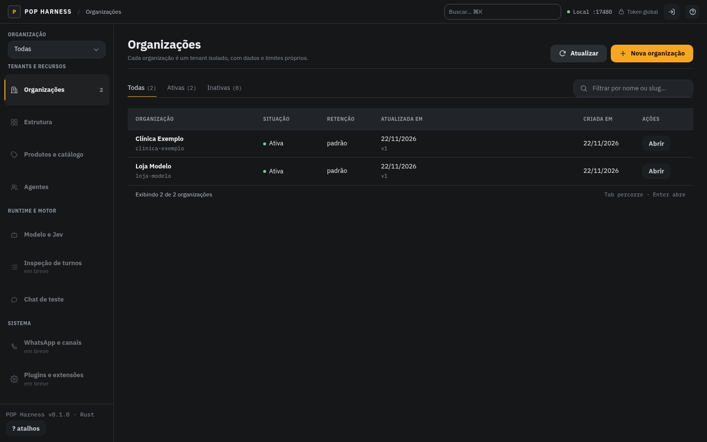
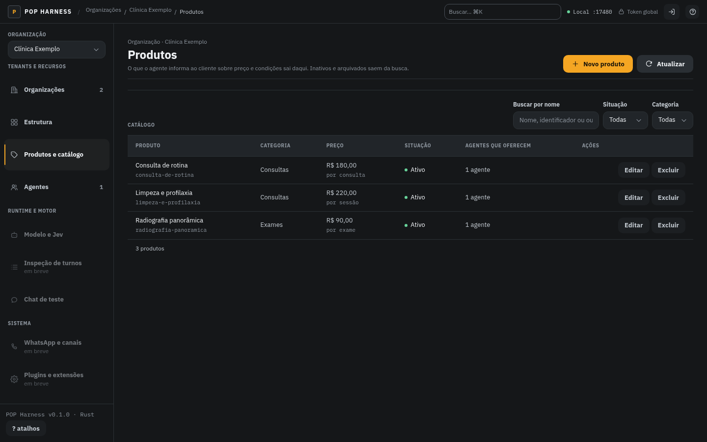

<div align="center">

# POP Harness

**Motor de atendimento por IA para várias empresas na mesma instância.**
Um binário em Rust, com SQLite. Sem Redis, sem Postgres e sem framework de agente.

[](https://github.com/vallewillian-source/pop-harness/actions/workflows/ci.yml)
[](LICENSE)
[](rust-toolchain.toml)
[](CONTRIBUTING.md)

[Início rápido](#início-rápido) ·
[O que ele faz](#o-que-ele-faz) ·
[Fluxos e Fichas](#fluxos-e-fichas) ·
[Atendimento humano](#atendimento-humano-com-matrix-e-element) ·
[Documentação](#documentação) ·
[Contribuir](#contribuir)

[English](README.md) · Português

</div>

> Esta é a tradução do [README principal, em inglês](README.md). Se houver diferença, vale o em inglês.
> Os guias de contribuição, segurança e suporte estão em inglês.

---

## O que é

O POP Harness recebe a mensagem do cliente, decide o que fazer, consulta a base de conhecimento e o
catálogo da empresa, escreve a resposta com um modelo de linguagem, entrega pelo canal de onde a mensagem
veio e registra cada passo para que a resposta possa ser explicada depois.

Ele foi desenhado para quem precisa **rodar muitos agentes de atendimento de empresas diferentes no mesmo
servidor**, com cada empresa isolada das outras, e passar a conversa para uma pessoa quando for preciso.

Na prática, você ganha:

- **Uma instalação, várias empresas.** Cada empresa (org) tem agentes, base de conhecimento, produtos,
  arquivos, integrações e tokens próprios. Nada é compartilhado entre elas.
- **Um único processo.** O binário `poph` traz a CLI, a API administrativa, o Console web (React, embutido)
  e o servidor. Os dados ficam em dois arquivos SQLite e numa pasta de anexos.
- **Respostas que dá para explicar.** Cada turno grava o que o agente consultou, quais ferramentas usou,
  o que o Jev decidiu e quanto tempo cada etapa levou. O Console mostra isso no painel "por quê".
- **Passagem para humano.** Conversa transferida deixa de ser respondida pelo agente. A equipe atende pelo
  Element (Matrix) e a resposta chega ao cliente pelo mesmo canal.
- **Atendimentos com etapas.** Fluxos escritos como script de texto, que um agente de IA e uma pessoa
  conseguem ler, e uma Ficha por atendimento com o histórico do que foi feito.

> O projeto está na versão `0.x`: a API, os formatos de arquivo e os comandos podem mudar até a `1.0`.
> Veja [Limitações conhecidas](#limitações-conhecidas) antes de colocar em produção.

> **Estado em 22/11/2026: partes desta página descrevem o que está sendo construído.**
> Já funcionam no código: multi-org, agentes, base de conhecimento, WhatsApp, arquivos, Jev, Matrix/Element
> (texto) e a Ficha criada em cada atendimento. **Ainda em desenvolvimento:** os comandos `poph flow` e
> `poph ficha`, os efeitos e as revisões de fluxo, a mídia do Matrix (imagem e arquivo) e várias instâncias
> do Matrix. O quadro com o estado de cada item fica em [ROADMAP.md](ROADMAP.md). Quando um trecho abaixo
> não bater com o binário, vale o binário e o `ROADMAP.md`.

## Para quem é

**Faz sentido se você:**

- tem equipe técnica e quer hospedar o atendimento por IA com os próprios dados e as próprias chaves;
- atende várias empresas (agência, software house, SaaS) e precisa de isolamento entre elas;
- quer controlar o que o agente pode fazer: ferramentas habilitadas por agente, envio só de arquivos
  da biblioteca, passagem para humano configurável;
- se importa com consumo de memória e com poucas peças para operar.

**Provavelmente não é o que você procura se:**

- quer um produto pronto, com cadastro e cobrança, para uma empresa sem equipe técnica. O Harness é o
  motor: o Console é administrativo e não é uma área de cliente final;
- precisa de áudio, vídeo, e-mail ou widget de site. Hoje o canal nativo é o WhatsApp (pela EvolutionAPI)
  e há um contrato para escrever outros canais como plugin;
- precisa de um catálogo de provedores de LLM pronto. Hoje o cliente de modelo fala com um endpoint
  compatível com OpenAI (veja [Limitações](#limitações-conhecidas)).

## O que ele faz

### Atendimento

| Recurso | Como funciona |
|---|---|
| **Orgs (tenants)** | Isolamento por `org_id` em todas as tabelas, no índice de busca e nos caches. Token de org só enxerga a própria org; token global administra todas. |
| **Agentes e instruções** | Instruções estruturadas (identidade, regras, escopo, passos, tom, ferramentas) compostas num prompt estável, ou prompt escrito à mão. A lista de ferramentas habilitadas **filtra de verdade** o que o agente pode chamar. Agente inativo não responde. |
| **Base de conhecimento** | Busca híbrida (vetorial + texto) sobre trechos curtos, com corte de relevância configurável por agente. O embedding roda **localmente** (MiniLM multilíngue, ONNX, int8): nenhum texto da base sai para um serviço de embedding. |
| **Produtos e orçamento** | Catálogo por categoria, busca de produto pelo nome, apelido ou etiqueta, e carrinho de orçamento por conversa. O agente consulta o catálogo em vez de inventar preço. |
| **Arquivos** | Entram imagens (vistas pelo modelo) e PDF/Office (lidos como texto, em processo isolado, com limite de memória e de tempo). O agente só envia arquivos da biblioteca dele, nunca um caminho livre. |
| **Memória da conversa** | Janela de contexto por orçamento de tokens, com resumo rolante. Conversa ociosa sai da memória e volta do banco. |
| **Janela de agrupamento** | Espera curta (padrão 2 s, teto 8 s) para juntar mensagens seguidas do cliente numa resposta só. |
| **Falha do modelo** | A mensagem é repetida depois, com limite de tentativas. O cliente não recebe aviso de erro e a mensagem não fica sem resposta. |

### Jev: decisões rápidas, opcionais

O **Jev** é um serviço externo que responde perguntas de escolha entre opções conhecidas (transferir ou
continuar, esperar mais ou processar, qual produto). Isso evita gastar o modelo de texto em decisões que
cabem numa classificação. O princípio é fixo: **o Jev escolhe, o código valida e executa, e a falha do
Jev cai no comportamento sem ele.**

| Gate | Decide | Padrão |
|---|---|---|
| G1 | transferir para uma pessoa agora | desligado |
| G2 | esperar mais mensagens ou processar agora | desligado |
| G3 | a mensagem precisa de base, produto ou nada | ligado |
| G4 | qual departamento recebe a transferência | desligado |
| G5 | qual produto o cliente quer | ligado |
| G6 | a resposta pode ser enviada ou deve ser reescrita | desligado |
| G7 | injeção de prompt ou abuso | desligado |
| G8 | o cliente encerrou a conversa | ligado |
| G9 | iniciar um fluxo (veja [Fluxos e Fichas](#fluxos-e-fichas)) | ligado quando o agente tem fluxo liberado |

O Jev é desligado por padrão (`jev.ativo = false`) e cada gate liga e desliga globalmente ou por agente.
Detalhes, medições e como calibrar: [`docs/JEV.md`](docs/JEV.md).

### Canais

| Canal | Situação |
|---|---|
| **WhatsApp** pela [EvolutionAPI](https://github.com/EvolutionAPI/evolution-api) | Nativo: webhook com deduplicação, pareamento por QR code pelo Console, envio de texto e arquivo, imagem e documento recebidos. |
| **Plugin em processo externo** | Qualquer programa que fale JSON-lines por stdio, com manifesto, segredos e configuração descritos por JSON Schema. O servidor supervisiona o processo com timeout e reinício. Modelo: [`crates/poph-plugin-eco`](crates/poph-plugin-eco). |
| **Chat de teste do Console e `poph chat`** | Conversa com o agente sem canal real, com streaming. |

Toda mensagem é entregue **pelo menos uma vez**: ela é gravada antes de o canal receber o OK e a saída
passa por uma fila durável. Se o processo cair no meio do envio, a mensagem é reenviada, e a duplicata
é a única falha possível. Contrato completo: [`docs/CONTRATO_CANAL.md`](docs/CONTRATO_CANAL.md).

### Operação

| Recurso | Como funciona |
|---|---|
| **Console web** | Organizações, estrutura (categorias e departamentos), produtos, agentes, base, arquivos, roteamento, integrações, modelo e Jev, chat de teste com painel "por quê", saúde da instância, exportar e importar org, Matrix. |
| **API administrativa** | `/admin/v1`, documentada em OpenAPI 3.1 (`/admin/v1/openapi.json`). Edição com `If-Match` (concorrência otimista), paginação por cursor e erros num formato único. |
| **CLI `poph`** | Tudo que o Console faz, também pelo terminal, com `--json` de formato estável. |
| **Cluster** | Várias instâncias com roteamento estático por org, num `cluster.toml` igual em todas. Webhook, chamadas administrativas e chat ao vivo caem na instância errada e são encaminhados com assinatura para a instância dona. |
| **Backup** | Uma org inteira num arquivo só, com restauração. Importar por cima de dados existentes é recusado por padrão. Segredos nunca vão em claro no arquivo. |
| **Retenção** | O histórico vence por org (padrão 30 dias; `0` não apaga). A varredura tem `--dry-run`. |
| **Observabilidade** | `/healthz`, métricas Prometheus em `/metrics`, logs legíveis ou em JSON, `poph doctor`. Segredos nunca vão para o log; os módulos Matrix e Fluxos também evitam texto de cliente e telefone nos logs. |
| **Segredos** | Só no ambiente. Segredos de integração ficam cifrados em repouso. O tipo `Sensivel` imprime `[oculto]` em log e em erro. Tokens de administração são guardados como hash Argon2id. |

## Como funciona



1. **Entrada.** O canal entrega a mensagem. Ela é gravada na `inbox` com chave única por canal e id
   externo, então duplicata é descartada. Se a org vive em outra instância, o pedido é encaminhado.
2. **Fila por conversa.** Um ator por conversa, um turno por vez.
3. **Agrupamento.** Espera curta para juntar mensagens em sequência.
4. **Em paralelo:** uma chamada ao Jev com as perguntas de todos os gates ligados e a busca na base e nos
   produtos. Se o G1 manda transferir, o turno termina sem chamar o modelo.
5. **Laço do agente.** Prompt com prefixo estável (aproveita o cache do provedor) e bloco volátil depois.
   Modelo com streaming e ferramentas habilitadas: `consultar_base`, `buscar_produto`, `enviar_arquivo`,
   carrinho e as de fluxo. Texto de arquivo e trecho recuperado entram marcados como **dado**, nunca como
   instrução.
6. **Saída.** A resposta vai para a `outbox`, idempotente por turno e sequência, e o canal envia.
7. **Registro.** O turno grava decisões do Jev, trechos recuperados, ferramentas, tempos e tokens.

Prioridades de projeto, nesta ordem: entregar a mensagem o mais rápido possível; usar pouca memória; escalar
na vertical (milhares de agentes) e na horizontal (várias instâncias); manter poucas dependências e poucos
processos. Detalhes: [`docs/VISAO_GERAL.md`](docs/VISAO_GERAL.md) e [`docs/TURNO.md`](docs/TURNO.md).

## Início rápido

Você vai compilar, criar uma org com um agente e conversar com ele pelo terminal e pelo Console.

### Requisitos

- Linux (x86_64 ou ARM64) com um compilador C (`gcc` ou `clang`): o SQLite e o TLS compilam código C.
- [Rust](https://rustup.rs). A versão (`1.100.0`) está fixada em [`rust-toolchain.toml`](rust-toolchain.toml)
  e o `rustup` instala sozinha.
- Para o Console: Node 22.18 ou mais novo e [pnpm](https://pnpm.io). Sem eles, o servidor sobe com uma
  página mínima no lugar do Console.
- Um endpoint de modelo de linguagem compatível com a API de chat da OpenAI, com streaming e ferramentas.
  Sem ele, tudo sobe e o Console funciona, mas o agente não responde.

### 1. Compilar

```bash
git clone https://github.com/vallewillian-source/pop-harness.git
cd pop-harness
cargo build --release --workspace
```

Saem `target/release/poph` e `target/release/poph-extrator`. Deixe os dois na mesma pasta: o segundo lê
PDF e Office em processo isolado. Nos comandos abaixo, `poph` é `target/release/poph`: copie os dois
para uma pasta do seu `PATH` ou use o caminho completo.

Para levar o Console dentro do binário, gere o bundle antes de compilar:

```bash
(cd console && pnpm install && pnpm build)
cargo build --release --workspace
```

### 2. Configurar

Crie um `poph.toml` mínimo:

```toml
[servidor]
porta = 7480

[dados]
diretorio = "data"

[llm]
url_base = "http://127.0.0.1:8045/v1"   # seu endpoint compatível com OpenAI
modelo   = "gemini-3.8-flash-tiered"    # o modelo que ele serve
```

Segredos ficam só no ambiente:

```bash
export POPH_CHAVE_CIFRA="$(head -c 32 /dev/urandom | base64)"   # guarde: ela cifra os segredos gravados
export ANTIGRAVITY_API_KEY='<a chave do seu endpoint de modelo>'
```

| Variável | Para que serve | Obrigatória |
|---|---|---|
| `POPH_CHAVE_CIFRA` | cifra dos segredos guardados | sempre |
| `ANTIGRAVITY_API_KEY` | chave do endpoint de modelo | sempre |
| `TYPESAFE_API_KEY` | Jev | só com o Jev ligado |
| `EVOLUTION_API_KEY` | WhatsApp pela EvolutionAPI | só com a seção `[evolution]` |
| `POPH_CLUSTER_SECRET` | assinatura entre instâncias | só com instâncias declaradas no `cluster.toml` |
| `POPH_MATRIX_AS_TOKEN`, `POPH_MATRIX_HS_TOKEN` | Application Service do Matrix | só com `[matrix]` ligado |

Todos os campos e variáveis: [`docs/CONFIGURACAO.md`](docs/CONFIGURACAO.md).

### 3. Conferir o ambiente e preparar os bancos

```bash
poph --config poph.toml doctor      # confere configuração, pasta de dados, bancos e variáveis
poph --config poph.toml migrate     # cria harness.db e rag.db; pode repetir
poph --config poph.toml model install   # baixa o modelo de embedding (precisa de internet)
```

Sem o modelo de embedding o servidor sobe e avisa, mas `consultar_base` e `buscar_produto` ficam
desligadas. O modelo tem cerca de 118 MB e a verificação do checksum é feita no download.

### 4. Criar a primeira org, o agente e o token

```bash
cat > prompt.md <<'EOF'
# Bia, atendente da Clínica Exemplo

Responda dúvidas sobre consultas, exames e preços, em português, de forma curta e cordial.
Use a base de conhecimento e o catálogo antes de responder. Se não souber, diga que vai
pedir para a equipe confirmar.
EOF

poph --config poph.toml org create --name "Clínica Exemplo" --slug clinica-exemplo --offline
poph --config poph.toml --org clinica-exemplo department create --name "Atendimento" --offline
poph --config poph.toml --org clinica-exemplo agent create --name "Bia" --offline
poph --config poph.toml --org clinica-exemplo instructions create bia --markdown-file prompt.md --offline
poph --config poph.toml token global --label console
```

O valor do token aparece **uma vez só**. `token global` também imprime um bloco `[admin]` com o hash: cole
no `poph.toml`, porque a configuração guarda só o hash.

### 5. Conversar

```bash
poph --config poph.toml --org clinica-exemplo chat bia          # pelo terminal, com streaming
poph --config poph.toml serve                                    # API + Console em http://127.0.0.1:7480
```

Abra `http://127.0.0.1:7480/`, entre com o token e use a aba **Chat de teste** do agente. Pelo terminal ou
pelo Console, a conversa funciona sem WhatsApp.

<p align="center">
  
</p>

Para conectar um número de WhatsApp, adicione a seção `[evolution]` (e `EVOLUTION_API_KEY`) e pareie por QR
code na aba **Integrações** do agente: [`docs/EVOLUTION.md`](docs/EVOLUTION.md).

## O Console

O Console fica embutido no binário e serve para administrar e testar. Entra-se com um token de administração
global ou de org.

<table>
  <tr>
    <td width="50%"></td>
    <td width="50%"></td>
  </tr>
  <tr>
    <td align="center"><sub>Organizações: cada uma é um tenant isolado.</sub></td>
    <td align="center"><sub>Catálogo que o agente consulta para informar preço.</sub></td>
  </tr>
</table>

As capturas usam dados de demonstração. Para desenvolver o Console com recarga automática: `cd console &&
pnpm dev` (abre em `http://localhost:5199` e encaminha a API para a porta 7480). Telas e comportamento:
[`docs/CONSOLE.md`](docs/CONSOLE.md).

## Comandos da CLI

Todos aceitam `--config <arquivo>`. Os que mexem em dados de uma org pedem `--org <slug>` e, em vários
casos, `--offline` (operam direto no banco). `poph <comando> --help` mostra as opções.

| Comando | Para que serve |
|---|---|
| `doctor`, `migrate`, `model install` | ambiente, bancos e modelo de embedding |
| `org`, `token` | orgs e tokens de administração (`token global` cria o global) |
| `agent`, `instructions` | agentes e instruções |
| `department`, `category`, `product` | departamentos, categorias e catálogo |
| `kb`, `rag`, `file` | base de conhecimento, índice de busca e biblioteca de arquivos |
| `flow`, `ficha` | fluxos (validar, publicar, comparar, formatar) e Fichas |
| `chat <agente>` | conversa pelo terminal |
| `matrix` | registro do Application Service e, por org, ligar, desligar e espaços |
| `cluster show`, `cluster check` | mostra e confere o mapa entre instâncias |
| `retention show`, `retention run --dry-run` | retenção do histórico |
| `backup export`, `backup import` | exporta e restaura uma org |
| `jev eval` | mede um gate do Jev contra um conjunto rotulado |
| `openapi` | imprime o documento OpenAPI |
| `serve` | sobe o servidor, a API e o Console |

## Fluxos e Fichas

### Ficha: o registro de cada atendimento

Toda conversa nasce com uma **Ficha**. Ela acumula mensagens, turnos e a execução dos fluxos daquele
atendimento, e só fecha quando o atendimento fecha: por quem atende, por um agente (`atendimento_encerrar`),
pela API ou por um fluxo que encerra. Depois disso, uma mensagem nova do cliente abre **outra conversa e
outra Ficha**. Uma Ficha fechada não muda mais.

### Fluxo: um script de texto

Um fluxo descreve etapas, campos, ações e decisões. Ele é um arquivo de texto em Starlark (um subconjunto do
Python), com declarações no nível do arquivo. O script **descreve**; o estado (etapa atual, campos
preenchidos, histórico) fica no banco. Por isso o cliente pode sumir e voltar dias depois, e uma queda do
servidor não perde o fluxo.

```python
fluxo(
    id = "triagem_suporte",
    nome = "Triagem de suporte",
    descricao = "Descobre o problema, classifica a urgência e encaminha o atendimento.",
    inicio = "relato",
    gatilho = gatilho(
        quando = "O cliente relata um problema técnico e precisa de ajuda para resolver.",
        nao_quando = "O cliente quer comprar, agendar visita ou falar de cobrança.",
        exemplos = ["meu sistema não abre", "deu erro ao emitir a nota"],
    ),
)

etapa(
    id = "relato",
    nome = "Ouvir o relato",
    instrucao = "Peça o que aconteceu e se o trabalho está parado agora. Uma pergunta por vez.",
    campos = [
        campo("resumo", "O que aconteceu", tipo = "texto", obrigatorio = True),
        campo("afeta_agora", "Está parado agora?", tipo = "opcao", opcoes = ["sim", "nao"], obrigatorio = True),
    ],
    acoes = [
        acao("registrado", "Relato registrado", exige = ["resumo", "afeta_agora"], vai_para = "classificar"),
        acao("nao_e_suporte", "Não é suporte", vai_para = fim("fora_de_escopo", resultado = "Fora do suporte")),
    ],
)

decisao(
    id = "classificar",
    se = igual("relato.afeta_agora", "sim"),
    entao = "urgente",
    senao = "normal",
)
```

Os três exemplos completos, validados a cada rodada, estão em [`tests/fluxos/exemplos`](tests/fluxos/exemplos).

O que isso resolve na prática:

- **Pertence à org, e o agente só recebe a permissão.** Fluxo novo não é usado por nenhum agente até alguém
  liberá-lo. Trocar de agente não perde o fluxo.
- **Quem decide começar é o Jev (G9); quem inicia é o código.** O Jev escolhe o fluxo entre os liberados ao
  agente, o código confere (fluxo ativo, liberado, Ficha aberta, revisão publicada) e só então inicia, antes
  de o modelo escrever. Se o Jev falhar, o modelo recebe a ferramenta `fluxo_iniciar` como reserva.
- **Revisões imutáveis.** Publicar cria a revisão `n+1`. Cada execução fica presa à revisão com que
  começou. `flow diff` mostra, em português, o que mudou e quantos atendimentos em andamento continuam na
  revisão antiga.
- **Erros que dizem o que fazer**, com linha e coluna: "a ação `confirmar` exige o campo `cep`, que não
  existe na etapa `coleta`". Avisos (etapa sem saída, campo nunca exigido, variável inexistente em
  mensagem) não bloqueiam a publicação.
- **O agente não avança sozinho.** Se a ação pedida não existe na etapa atual, a resposta é o erro e a lista
  de ações válidas. Não há transição escondida.
- **Efeitos explícitos**: mensagem fixa ao cliente, notificação de WhatsApp para um número da equipe e
  encaminhamento para departamento. Saem por fila durável; falha de efeito não desfaz a transição e aparece
  como evento na Ficha.
- **Script é entrada não confiável.** Sem relógio, rede, arquivo ou aleatório, com limite de tamanho, de
  passos e de memória por avaliação. `while`, recursão e `"x" * 1000000000` terminam em erro, sem travar o
  servidor.

```bash
poph --org clinica-exemplo flow validar triagem_suporte.star      # erros e avisos, sem gravar
poph --org clinica-exemplo flow publicar triagem_suporte.star
poph --org clinica-exemplo flow diff triagem_suporte --de 1 --para 2
poph --org clinica-exemplo ficha listar --status open
```

Linguagem completa, tabela "o que configurar → o que acontece" e lista de diagnósticos:
[`docs/FLUXOS_LINGUAGEM.md`](docs/FLUXOS_LINGUAGEM.md).

## Atendimento humano com Matrix e Element

O módulo `poph-matrix` espelha cada conversa numa sala do Matrix para a equipe atender pelo
[Element](https://element.io), e devolve ao cliente o que o atendente escreve. Ele é **desligável** (seção
`[matrix]` ausente ou `habilitado = false` e nada dele carrega) e **não fica no caminho do cliente**: lê o
que o turno já gravou e publica no Synapse. Com o Synapse fora do ar, o atendimento ao cliente continua e a
fila esgota quando ele volta.

- **Uma sala por conversa**, com o nome do cliente (o nome de perfil do WhatsApp; sem ele, o telefone), o
  texto do cliente e as respostas do agente, em ordem e sem duplicata.
- **Espaços por departamento.** A sala vai para o espaço do departamento da conversa e muda de espaço quando
  a conversa é transferida. O espaço pode ser criado pelo módulo ou ligado a um que já existe no Element.
- **Resposta do atendente.** O que a pessoa escreve no Element chega ao cliente pelo mesmo canal, com o
  nome dela (`*[Nome]*:`) na frente, e a conversa passa a `transferred`: o agente para de responder. Ele só
  volta com a reabertura no Console. Uma transação repetida pelo Synapse não gera segundo envio.
- **Avisos na sala**: transferência, reabertura, encerramento e falha definitiva de entrega ao cliente.
- **Encerrar pelo Element.** O botão de encerrar atendimento, a leitura da conversa e o histórico do cliente
  no painel da sala são atendidos pela API do Harness (`GET/close` de conversa, listagem por cliente).
- **Mídia e mensagens do aparelho.** Imagem e arquivo nos dois sentidos (até 16 MB), aviso em texto para
  áudio e vídeo, e a mensagem digitada direto no celular do cliente aparece como "Humano no Aparelho" e
  também pausa o agente.
- **Várias instâncias no mesmo Synapse**, cada uma dona das salas que criou.

```toml
[matrix]
habilitado     = true
homeserver_url = "https://synapse.exemplo.com"
server_name    = "exemplo.com"
prefixo        = "ph"        # prefixo dos usuários virtuais e aliases (diferente de outras integrações do Synapse)
```

```bash
export POPH_MATRIX_AS_TOKEN='<token do application service>'
export POPH_MATRIX_HS_TOKEN='<token do homeserver>'

poph matrix registro --saida registro.yaml --url https://harness.exemplo.com   # gera o registro (arquivo 0600, sem imprimir token)
# adicione registro.yaml ao Synapse e reinicie o Synapse: ele só lê registros na subida

poph --offline --org clinica-exemplo matrix ligar
poph --offline --org clinica-exemplo matrix espaco --departamento <id>
```

O Synapse e o Element são **seus**: o Harness não os instala nem os altera. O roteiro de um Synapse de
desenvolvimento com dois registros está em [`docs/MATRIX_AMBIENTE_LOCAL.md`](docs/MATRIX_AMBIENTE_LOCAL.md).
Medição de memória, vazão e resiliência: [`docs/MATRIZ_MEMORIA.md`](docs/MATRIZ_MEMORIA.md) e
[`docs/MATRIZ_RESILIENCIA.md`](docs/MATRIZ_RESILIENCIA.md).

## Números medidos

Estes números vêm de spikes e medições de desenvolvimento (x86_64, uma máquina de 12 núcleos). **Não são um
teste de carga completo**: o teste com 10 mil agentes e 500 conversas ativas ainda não foi feito, então as
metas de escala abaixo são metas, não resultado.

| O que | Medido |
|---|---|
| Memória por agente ocioso (configuração completa) | 8,3 KB; 10 mil agentes = 84 MB |
| Memória por agente com índice vetorial (200 trechos × 384 dimensões, int8) | 82,9 KB |
| Busca exata dos 3 melhores trechos entre 200 | 13,5 µs (p50) |
| Caminho interno do turno, da mensagem ao pedido ao modelo pronto (sem embedding, Jev e modelo) | 0,057 ms (p50) |
| SQLite com um escritor em lote | 118 mil mensagens/s saturado; commit de 0,2 ms (p95) a 2.000 msg/s |
| `poph serve` com o módulo Matrix desligado (sem o modelo de embedding carregado) | ~20 MB de RSS |
| Módulo Matrix ligado, 1.000 salas | +6,5 MB sobre o servidor sem o módulo |
| Modelo de embedding carregado | ~458 MB de RSS |

A latência que o cliente percebe é dominada pelo modelo de linguagem (no spike: primeiro texto em ~6,5 s e
resposta completa em ~6,9 s), não pelo Harness. Método, ressalvas e como repetir: [`docs/DECISOES.md`](docs/DECISOES.md)
(D-07), [`docs/MATRIZ_MEMORIA.md`](docs/MATRIZ_MEMORIA.md) e [`docs/MEMORIA_E_CONCORRENCIA.md`](docs/MEMORIA_E_CONCORRENCIA.md).

## Limitações conhecidas

Antes de produção, confira esta lista. Ela é mantida junto com o código.

- **Modelo de linguagem.** O cliente de modelo está atrás de uma interface (`LlmProvider`), mas o único
  provedor incluído fala o dialeto de chat da OpenAI (`/chat/completions`, SSE, ferramentas, imagens) e foi
  exercitado só contra um gateway específico. O identificador do provedor na configuração ainda é
  `antigravity2api`. Outros endpoints compatíveis **não foram testados**.
- **Jev.** É um serviço de terceiros. Sem ele, o Harness funciona no comportamento padrão de cada gate,
  mas sem as decisões rápidas. O G1 (transferir) vem desligado até uma nova rodada de medição.
- **WhatsApp com número real.** O canal foi provado com uma EvolutionAPI falsa e em ambiente isolado. O
  teste com número real ainda está pendente.
- **Plugin externo como canal.** O contrato, o supervisor e o plugin de exemplo estão prontos e testados,
  mas o `poph serve` hoje só sobe o plugin para ler o manifesto. Receber e enviar mensagens de cliente por
  plugin externo dentro do servidor ainda não está ligado.
- **Escala.** As metas de memória e vazão para milhares de agentes estão fixadas, mas o teste de carga
  completo e a paridade de busca medida com um agente real ainda não foram feitos.
- **ARM64.** O build é validado, mas o binário ARM do último commit não foi reconstruído em máquina ARM.
- **Sem usuário final no Console.** O Console entra com o token de administração; não há login de pessoa,
  papéis nem rate limit por token.
- **Só Linux.** Não testamos macOS nem Windows.
- **Console fora do monorepo do POP Atende.** O Console depende do pacote `@sofacoding/sofa-ui`, que ainda
  não foi publicado. Sem ele, `cargo build` e `poph serve` funcionam e abrem uma página mínima, mas o
  bundle completo do Console não compila a partir deste repositório.

## Arquitetura do código

Um workspace Cargo com crates pequenos e uma regra de dependência: `poph-types` não depende de nenhum
outro, os crates de capacidade não conhecem o servidor nem a CLI, e quem junta as peças é `poph-agent`
(turno) e `poph-server` (HTTP).

| Crate | O que faz |
|---|---|
| `poph-types` | tipos de domínio, IDs, erros, contratos, configuração e `Sensivel` |
| `poph-core` | cliente do provedor de modelo (streaming, ferramentas, imagens, limite por org) |
| `poph-store` | SQLite (`harness.db`, `rag.db`): um escritor, leitores em WAL, migrações, repositórios por org, backup |
| `poph-rag` | embedding local (ONNX Runtime, int8), fila de lote e instalação do modelo |
| `poph-files` | recebimento de arquivos, tipo pelo conteúdo, extração de PDF/Office em processo isolado |
| `poph-jev` | cliente do Jev, framework de gates e lote único de perguntas |
| `poph-fluxos` | compilador, validador, regras e motor dos fluxos; puro, sem banco nem rede |
| `poph-plugins`, `poph-plugin-eco` | supervisão de plugins por stdio e plugin de exemplo |
| `poph-evolution` | cliente da EvolutionAPI (WhatsApp) |
| `poph-matrix` | módulo Matrix: Application Service, salas, espaços e usuários virtuais |
| `poph-agent` | estado quente, atores por conversa, turno, contexto, base, produtos e carrinho |
| `poph-retention` | retenção do histórico |
| `poph-server` | API administrativa (axum), autenticação, OpenAPI, Console embutido, cluster |
| `poph` | o binário: CLI e `serve` |

Mapa completo, regras de trabalho e onde fica cada regra de negócio: [`AGENTS.md`](AGENTS.md).

## Documentação

| Para | Leia |
|---|---|
| Entender o projeto | [`docs/VISAO_GERAL.md`](docs/VISAO_GERAL.md), [`docs/DECISOES.md`](docs/DECISOES.md) |
| Configurar e operar | [`docs/CONFIGURACAO.md`](docs/CONFIGURACAO.md), [`docs/RUNBOOKS.md`](docs/RUNBOOKS.md), [`docs/CLUSTER.md`](docs/CLUSTER.md), [`docs/BACKUP.md`](docs/BACKUP.md), [`docs/RETENCAO.md`](docs/RETENCAO.md) |
| Usar a API | [`docs/API.md`](docs/API.md) e `/admin/v1/openapi.json` |
| Como uma mensagem vira resposta | [`docs/TURNO.md`](docs/TURNO.md), [`docs/ENTRADA_E_SAIDA.md`](docs/ENTRADA_E_SAIDA.md), [`docs/MEMORIA_E_CONCORRENCIA.md`](docs/MEMORIA_E_CONCORRENCIA.md) |
| Agentes, base e produtos | [`docs/AGENTES.md`](docs/AGENTES.md), [`docs/BASE_DE_CONHECIMENTO.md`](docs/BASE_DE_CONHECIMENTO.md), [`docs/PRODUTOS.md`](docs/PRODUTOS.md), [`docs/ARQUIVOS.md`](docs/ARQUIVOS.md) |
| Jev | [`docs/JEV.md`](docs/JEV.md) |
| Canais e plugins | [`docs/CONTRATO_CANAL.md`](docs/CONTRATO_CANAL.md), [`docs/PLUGIN_PROTOCOLO.md`](docs/PLUGIN_PROTOCOLO.md), [`docs/PLUGIN_EXEMPLO.md`](docs/PLUGIN_EXEMPLO.md), [`docs/EVOLUTION.md`](docs/EVOLUTION.md) |
| Fluxos e Fichas | [`docs/FLUXOS_LINGUAGEM.md`](docs/FLUXOS_LINGUAGEM.md) |
| Matrix e Element | [`docs/MATRIX_AMBIENTE_LOCAL.md`](docs/MATRIX_AMBIENTE_LOCAL.md), [`docs/DADOS.md`](docs/DADOS.md) §11 |
| Dados e esquema | [`docs/DADOS.md`](docs/DADOS.md) |
| Console | [`docs/CONSOLE.md`](docs/CONSOLE.md), [`console/UX_SPEC.md`](console/UX_SPEC.md) |
| Mexer no código | [`CONTRIBUTING.md`](CONTRIBUTING.md), [`DEVELOPMENT.md`](DEVELOPMENT.md), [`AGENTS.md`](AGENTS.md) |
| Próximos passos | [`ROADMAP.md`](ROADMAP.md) |

## Contribuir

Contribuições são bem-vindas: correção de erro, teste, documentação, plugin de canal, provedor de modelo
novo. Antes de abrir um pull request grande, abra uma issue para alinhar o desenho.

- Leia [`CONTRIBUTING.md`](CONTRIBUTING.md): como preparar o ambiente, rodar os testes, o estilo e o que
  esperamos num PR.
- O comando único de verificação é `bash scripts/ci.sh` (formatação, clippy com `-D warnings`, testes,
  checagem ARM, licenças e auditoria de dependências).
- Procure as issues marcadas com `good first issue` e `help wanted`.
- Participar do projeto é aceitar o [Código de Conduta](CODE_OF_CONDUCT.md).
- Dúvidas de uso vão em [Discussions](https://github.com/vallewillian-source/pop-harness/discussions). Veja
  [`SUPPORT.md`](SUPPORT.md).

## Segurança

Não abra issue pública para falha de segurança. Use o relato privado do GitHub
(**Security → Report a vulnerability**). O processo está em [`SECURITY.md`](SECURITY.md).

## Licença

O POP Harness é distribuído sob a [GNU Affero General Public License v3.0 ou posterior](LICENSE)
(`AGPL-3.0-or-later`). Em resumo: você pode usar, estudar, modificar e redistribuir, inclusive
comercialmente. Se você oferecer uma versão modificada como serviço pela rede, precisa disponibilizar o
código-fonte dessa versão aos usuários do serviço. Leia o texto da licença para os termos exatos.

## Créditos

Criado e mantido pela [SofaCoding](https://sofacoding.com.br). O projeto vem do trabalho no
[POP Atende](https://popatende.com.br), mas é independente dele: não usa o banco dele nem importa código
dele. "POP Harness" e "POP Atende" são nomes de produtos da SofaCoding.

O Harness usa, entre outros: [axum](https://github.com/tokio-rs/axum), [rusqlite](https://github.com/rusqlite/rusqlite),
[ONNX Runtime](https://onnxruntime.ai) via [`ort`](https://github.com/pykeio/ort), [Starlark](https://github.com/facebook/starlark-rust)
e o modelo [paraphrase-multilingual-MiniLM-L12-v2](https://huggingface.co/sentence-transformers/paraphrase-multilingual-MiniLM-L12-v2).
A lista completa de dependências e licenças está em `Cargo.lock` e é verificada pelo `cargo deny`.
